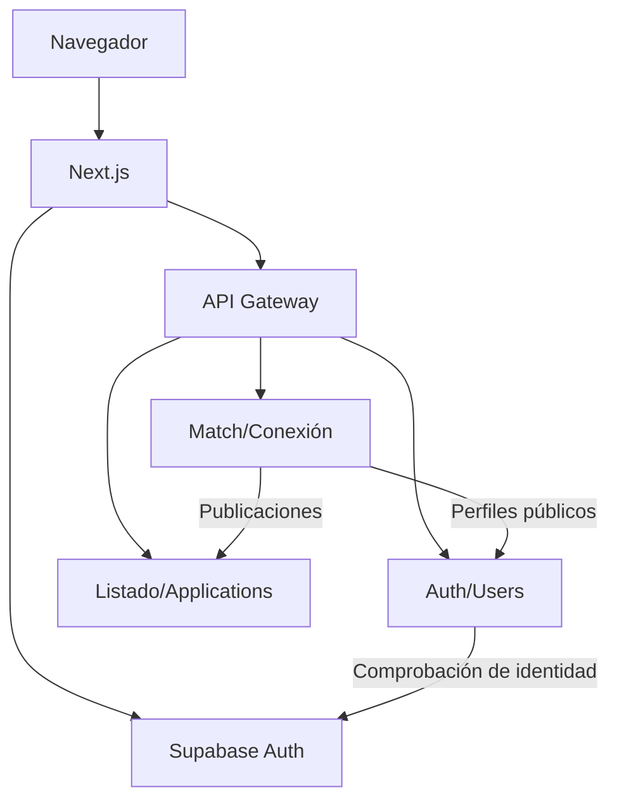

# SCRUM-99 · Anexo técnico de reconciliación de ramas

**Estado en revisión.** Al corte del 18/11/2026, el equipo identifica tres commits publicados en el [PR #42 hacia `dev-web`](https://github.com/Benjitapley/taller-de-integra-/pull/42): `a3f5bed` (reconciliación y anexo), `8b9611e` (PKCE) y `013e105` (documentación de S3R-B01). Este cotejo corresponde al código de `013e105`. La integración y la verificación del entorno de entrega siguen pendientes.

**Fuentes de alcance:** *Roomies_Backlog_TI2_Sprint3_v1.4.pdf*, versión 1.4, 15/11/2026: sección 2 y decisiones D06 y D08–D12 (p. 5), arquitectura (p. 7), calendario/capacidad (pp. 9–10), definición de terminado (p. 11), S3R-B01 (pp. 15–16), y S3R-B02 (p. 16). El backlog define criterios; este documento distingue **implementación**, **verificación** y **confirmación humana**.

**Referencia contractual vigente recibida del equipo.** El Scrum Master distribuyó *Contrato_Microservicios_Roomies_Sprint3_v2_editado.pdf*, fechado el 18/11/2026. Se revisaron las 27 páginas del ejemplar con SHA-256 `78a292d7eed3c1311c61a04f60a85b9ca9c6233beeda2f54ae2e5729cd1a15e9`. Define API pública por Gateway, API interna, DTO, permisos, errores, eventos, incorporación a un arriendo y almacenamiento de imágenes para Auth/Users, Listado/Applications, Match/Conexión, Convivencia/Mensajería y Reputación/Historial/Reportes. La [matriz contractual](contracts/SCRUM-99-contrato-alcance-S3-v1.4.md) identifica qué existe en el repositorio y qué puede consumir cada cliente. Faltan constancia de aprobación formal y recepción por TI4.

## 1. Objetivo y alcance

Trasladar a la línea web los ajustes de comunicación entre microservicios y del registro con Supabase que el equipo había preparado sobre `main`. Este anexo identifica qué se trasladó, qué evidencia respalda el cambio y qué falta antes de integrarlo. La reconciliación inicial comprendió once archivos de código y este anexo. Los dos commits posteriores incorporaron la corrección PKCE y documentación complementaria. La aplicación móvil, las migraciones y la publicación de infraestructura quedan para decisiones separadas.

## 2. Estado inicial de las ramas

| Referencia local inspeccionada | Commit | Papel en la reconciliación |
|---|---|---|
| `origin/main` | `a798f3c` | Base original. Contiene la web en `taller-de-integra-dos/roomies-web` y un árbol de TI IV en `taller de integra cuatro`. |
| `feature/SCRUM-99-reconciliacion` | `a798f3c` | Rama del trabajo de origen, según el equipo. La referencia apunta a ese commit. Los cambios originales fueron trasladados desde el árbol de trabajo mediante el parche. |
| `origin/dev-web` | `616747f` | Base elegida para integrar. Contiene la transición a Next.js y la web en `taller de integra dos/roomies-web`. |
| `SCRUM-99-Cerrar-la-reconciliación-de-ramas-y-publicar-el-anexo-técnico` | `616747f` al crearla | Rama de Jira creada desde `dev-web`. La columna conserva **el estado inicial**, no el estado actual. |

La inspección se hizo en `C:\Proyectos\roomies-scrum99-dev-web`. **Corte posterior:** la rama local y su referencia de seguimiento apuntan a `013e105`, después de `a3f5bed` y `8b9611e`. El responsable confirmó el [PR #42](https://github.com/Benjitapley/taller-de-integra-/pull/42), **origen** la rama de Jira y **base** `dev-web`. El SHA remoto actual de `dev-web` debe volver a comprobarse antes del merge; `616747f` es la base inspeccionada, no una afirmación de que sigue siendo el último commit del destino.

## 3. Motivo para evitar un merge completo

El ancestro común de las referencias inspeccionadas es `1d50ba5`. La comparación `git rev-list --left-right --count origin/main...origin/dev-web` dio **98 commits exclusivos de main y 23 de dev-web**. Son recuentos de historia, no de funcionalidades pendientes. Un merge habría obligado a resolver simultáneamente diferencias de rutas, documentación, código móvil e historia de la web que excedían la decisión de SCRUM-99.

## 4. Traslado selectivo

Según el registro del equipo, se preparó `SCRUM-99-devweb-transfer.patch` a partir de los cambios originales y se aplicó sobre la rama de Jira con la carpeta web de `dev-web` como destino. La auditoría revisó el resultado en el worktree de destino. No fue necesario abrir el repositorio original ni volver a aplicar el parche.

El primer diff contenía **11 archivos, 183 inserciones y 19 eliminaciones**. Tras retirar una entrada de prueba con carácter nulo, el código antes del commit quedó en **11 archivos, 182 inserciones y 19 eliminaciones**. El commit **`a3f5bed`** publicó **12 archivos, 349 inserciones y 19 eliminaciones** (167 líneas nuevas del anexo). El commit **`8b9611e`** agregó la corrección y la prueba de PKCE en **2 archivos, 39 inserciones y 2 eliminaciones**. Las cifras son por commit, **no se deben sumar como si fueran archivos distintos**. Todos los cambios de SCRUM-99 pertenecen al árbol web; no incluye operaciones de traslado del móvil.

## 5. Inventario de los once archivos

Rutas relativas a `taller de integra dos/roomies-web`.

| Archivo | Cambio trasladado |
|---|---|
| `backend/service_runtime/settings.py` | Valida los orígenes de los servicios. Admite HTTP local con puerto explícito y HTTPS remoto en modo `supabase` para las tres variables de upstream previstas. Rechaza credenciales, rutas adicionales, consultas, fragmentos y caracteres inválidos. |
| `backend/local_stack/test_runtime.py` | Prueba destinos HTTPS permitidos, orígenes inválidos, nombres Docker y restricciones del modo desechable. Incluye la corrección de la sección 10. |
| `backend/services/match-conexion-service/app/infrastructure/clients.py` | Match admite `listado-applications`, nombre usado por Compose, además de `listado` al consultar publicaciones. |
| `docker-compose.local.yml` | Pasa `WEB_AUTH_RECOVERY_SECRET` al proceso web local. El valor por defecto queda vacío. |
| `frontend-next/src/app/(auth)/verificar/page.tsx` | Interpreta el estado `registro-recibido` y presenta una indicación informativa sobre el correo y el inicio de sesión. |
| `frontend-next/src/features/auth/AuthForm.tsx` | Tras el registro con Supabase, redirige a la verificación con el nuevo estado. |
| `frontend-next/src/features/auth/AuthScreen.tsx` | Distingue avisos informativos y errores al preparar la pantalla de confirmación. |
| `frontend-next/src/features/auth/EmailConfirmation.tsx` | Presenta la información con `role="status"` y mantiene los errores con `role="alert"`. |
| `frontend-next/src/lib/auth/gateway.ts` | Deriva la opción de autoconfirmación local del modo de laboratorio y de que el entorno esté fuera de producción. |
| `frontend-next/src/lib/auth/supabase.ts` | Unifica la respuesta pública del registro nuevo y duplicado, trata `429`/`503` y admite autoconfirmación local. En `8b9611e` reutiliza un verificador PKCE válido de la cookie cuando existe para no invalidar el enlace anterior por un registro duplicado. |
| `frontend-next/tests/supabase-auth.test.mjs` | Añade casos para registro duplicado, confirmación requerida, autoconfirmación local y errores. En `8b9611e` incluye regresión de registro inicial → segundo intento duplicado → confirmación con enlace original, usando un proveedor simulado. |

## 6. Arquitectura y responsabilidades

Los dos manifiestos Compose definen cinco componentes de aplicación. El modo local añade PostgreSQL como dependencia. El frontend incluye una capa de servidor que gestiona la autenticación web y las cookies. El API Gateway de FastAPI es otro proceso y distribuye las peticiones de dominio.

| Componente | Responsabilidad en el flujo revisado |
|---|---|
| Next.js, `next-web` | Sirve la interfaz. En modo Supabase, su código de servidor coordina registro, confirmación PKCE y sesión. Envía las peticiones de dominio al gateway. |
| `api-gateway` | Encauza peticiones hacia Auth/Users, Listado/Applications y Match/Conexión según la ruta y el upstream configurado. |
| `auth-users` | Comprueba la identidad para las operaciones protegidas y gestiona perfiles y consultas de usuarios públicos. Supabase Auth actúa como proveedor de identidad en el modo correspondiente. |
| `listado-applications` | Gestiona publicaciones y postulaciones. Expone datos de publicaciones que consume Match. |
| `match-conexion` | Gestiona conexiones y búsquedas. Consulta perfiles públicos a Auth/Users y publicaciones a Listado/Applications por HTTP. |

## 7. Diagrama del modo Supabase

Las flechas representan dependencias presentes en el código o en Compose. El diagrama describe la topología configurada y omite el almacenamiento para destacar las llamadas entre componentes.



## 8. Entornos y evidencia disponible

| Entorno | Evidencia verificada | Pendiente de comprobar en ejecución |
|---|---|---|
| Desarrollo Windows | Pruebas locales con Python 3.13.3 en `.venv313` y dependencias npm instaladas. ESLint pasó en el frontend. | Transporte HTTP local y suites dependientes de sockets o enlaces de directorio. |
| Docker local | `docker-compose.local.yml` define web, gateway, tres servicios de dominio y `roomies-db`. Publica web y gateway por loopback en 3000 y 8010. | Arranque conjunto, salud y recorrido completo de una petición con esta revisión. |
| Supabase | `docker-compose.supabase.yml` define el modo compartido con proveedor de identidad y conexiones PostgreSQL por rol. Los tests de autenticación usan respuestas controladas. | Proyecto objetivo, confirmación de correo real, persistencia y sesión de extremo a extremo con cuentas de prueba. |
| Render | El validador admite orígenes HTTPS configurados para los tres upstreams en modo Supabase. | Inventario, revisión desplegada, salud y conectividad del gateway y los tres servicios de dominio. |
| Vercel | `frontend-next/vercel.json` declara Next.js, `npm ci` y `npm run build`. El equipo observó en el PR #42 **dos comprobaciones de despliegue fallidas** (`taller-de-integra-` y `taller-de-integra--frontend-next`), y **Vercel Preview Comments aprobada**. | Determinar la primera causa de cada error desde los logs de deployment; verificar configuración, rama y directorio raíz. **No se atribuye el fallo al código sin logs.** |

| Kubero (objetivo Sprint 3) | El backlog v1.4, D08 y S3R-B02, dispone **PostgreSQL de negocio en Kubero** y fija que el host de procesos depende de la red y permisos probados. | Confirmar pipeline, roles, volúmenes persistentes, acceso SQL y topología real. **No es un despliegue verificado por SCRUM-99.** |

La evidencia de SCRUM-99 **no acredita un despliegue de los cinco servicios objetivo**. El código inspeccionado contempla Auth/Users, Listado/Applications y Match/Conexión como procesos de dominio existentes, más Gateway y frontend. El alcance posterior de Sprint 3 añade Convivencia/Mensajería y Reportes, sin considerarlos implementados o desplegados por aparecer en el backlog. Supabase Auth se mantiene externo; la base de negocio es la que deberá residir en Kubero tras S3R-B02/B03. No se publican valores operativos secretos.

## 9. Evidencia de validación

Resultados registrados sobre la rama de integración **en momentos diferentes**. Después de eliminar el caso `\x00` se repitió la suite de configuración. Antes de crear el segundo commit, Codex ejecutó en el worktree con la corrección PKCE que luego se publicó en `8b9611e` **Supabase Auth (19/19)**, **validación de autenticación (13/13)**, **cliente de autenticación (4/4)** y **sesión (14/15)**. No se repitieron todas las suites históricas tras `8b9611e`: los resultados se identifican por etapa y **no se suman como una única ejecución**. No se realizó aún una confirmación de correo con Supabase real.

| Backend | Resultado |
|---|---|
| `backend/local_stack/test_runtime.py` | Antes de la corrección, 56 aprobadas y 1 fallida. Resultado final, **56 de 56 aprobadas**. |
| `backend/local_stack/test_auth.py` | 9 de 9 aprobadas. |
| `backend/local_stack/test_listado.py` | 18 de 18 aprobadas. |
| `backend/local_stack/test_match.py` | 6 de 6 aprobadas. |
| Clientes HTTP | Dos escenarios adicionales con transporte simulado aprobados en la revisión inicial. |
| `backend/api-gateway/tests/test_gateway.py` | 110 casos recopilados. La ejecución se detuvo en el primero, sin resultado de suite. |
| `backend/tests/run_isolated.py` | 133 casos recopilados. La ejecución se detuvo en el primero, sin resultado de suite. |

| Script del frontend | Resultado |
|---|---|
| `test:auth` | 13 de 13 aprobadas. |
| `test:auth-client` | 4 de 4 aprobadas. |
| `test:supabase-auth` | En `a3f5bed`: 18 de 18 aprobadas. **En el worktree antes de publicar `8b9611e`: 19 de 19 aprobadas**, incluida la nueva regresión PKCE con proveedor simulado; antes del cambio la misma prueba falló. |
| `test:session` | 14 aprobadas de 15. El caso con servidor HTTP local recibió 503 y esperaba 200. |
| `test:api` | 7 de 7 aprobadas. |
| `test:admin` | 4 de 4 aprobadas. |
| `test:profile` | 15 de 15 aprobadas. |
| `test:applications` | 4 de 4 aprobadas. |
| `test:publications` | 9 de 9 aprobadas. |
| `test:connections` | 6 de 6 aprobadas. |
| `test:proxy` | 1 caso, bloqueado durante la preparación del entorno. |
| `lint` | ESLint terminó con código 0. |
| `typecheck` | `next typegen && tsc --noEmit` terminó con código 0. |
| `build` | Next.js 16.4.3 terminó con código 0 y generó las 4 páginas estáticas previstas. |

TypeScript y build se ejecutaron **antes de `8b9611e`** en una copia temporal dentro del worktree. Antes de ejecutarlos se comparó el contenido de los archivos versionados copiados con los del frontend, excluida la plantilla `.env.example`. **No hay evidencia documentada de repetir typecheck/build sobre el commit `8b9611e`**. Compilar y probar con dobles acredita solo esas condiciones. La entrega real de correo, la conexión entre servicios y el despliegue necesitan evidencia propia. En el corte comunicado para PR #42, el equipo observó **2 fallos de deployment en Vercel y 1 comprobación de comentarios exitosa**; el primer error de los logs sigue sin inspeccionar.

## 10. Corrección del caso con carácter nulo

El parámetro que contenía `\x00` fallaba en `monkeypatch.setenv()` con `ValueError: embedded null character`. Python rechazaba el valor antes de invocar `service_url()`. Se retiró exclusivamente esa entrada. Permanecen las demás URLs inválidas. Las huellas SHA-256 de los otros diez archivos, incluido el validador, coincidieron antes y después.

Desde la carpeta web se ejecutó:

```powershell
& '..\..\.venv313\Scripts\python.exe' -B -m pytest -q -p no:cacheprovider backend/local_stack/test_runtime.py
```

Resultado: **56 passed in 0.33s**. `git diff --check` terminó con código 0. La suite final cubre el conjunto de valores que quedó parametrizado.

## 11. Limitaciones reproducidas

| Comprobación | Punto de bloqueo | Evidencia que falta |
|---|---|---|
| API Gateway Python y backend aislado | Las trazas sitúan la espera en `socket.accept()` al crear el par de sockets interno de `asyncio` en Windows. Se interrumpieron las ejecuciones. | Resultado completo de ambas suites en un ejecutor que permita loopback. Los 243 casos recopilados quedaron sin veredicto. |
| Gateway de sesión web | Una conexión independiente al servidor de prueba en `127.0.0.1` reprodujo `EACCES`. | Repetir `test:session` con transporte local permitido y verificar el 200 esperado. |
| Proxy Next.js | La creación del enlace de directorio a `node_modules` falló con `EPERM`, antes de probar las rutas. | Repetir `test:proxy` con permiso para crear ese enlace y abrir sockets locales. |

## 12. Riesgos y observaciones HTTP

- **Errores preexistentes del proveedor.** La revisión estática encontró que login puede presentar un `5xx` como `401`, el reenvío como `422` y la verificación por código como `400`. Esto dificulta distinguir una caída del proveedor de un problema con los datos introducidos. El registro revisado traduce los `5xx` a `503`.
- **Límite de solicitudes.** El registro conserva `429` y sigue omitiendo `Retry-After`. El cliente carece del plazo que haya indicado el proveedor.
- **Destinos de servicios.** La validación comprueba modo, variable y sintaxis del origen. La selección del dominio y su resolución DNS dependen de la configuración operativa. Los clientes revisados de Match usan un timeout de cinco segundos y deshabilitan redirecciones y proxies heredados del entorno.
- **Recuperación local.** Compose permite dejar vacío `WEB_AUTH_RECOVERY_SECRET`. La recuperación responderá `503` si el secreto no cumple el mínimo de 32 caracteres. La autoconfirmación de laboratorio está acotada al entorno local fuera de producción.

## 12.1. Regresión PKCE detectada y corregida en `8b9611e`

El análisis de `a3f5bed` detectó que cada `signUp` creaba un verificador PKCE nuevo y que la respuesta neutral `user_already_exists` sobrescribía la cookie de confirmación. Un enlace de correo previo, generado con el verificador inicial, podía terminar en `estado=enlace-invalido` cuando el callback leía el verificador reemplazado.

Se agregó una prueba de regresión que ejecuta **registro inicial pendiente → intento duplicado en el mismo navegador → confirmación mediante el enlace original**. El proveedor Supabase se simuló y se verificó la correspondencia del desafío S256: la prueba falló antes del arreglo y pasó después. La corrección en `supabase.ts` emplea `readPkce(request, config) || randomBytes(48).toString("base64url")`, reutilizando el verificador válido presente y generando uno nuevo cuando no existe. La respuesta pública neutral y los casos `429`, `503` y autoconfirmación local permanecieron cubiertos por el conjunto de 19 tests aprobados. El callback redirigió a `/?correo=verificado` y eliminó la cookie en el escenario simulado.

**Límite:** la cookie está asociada al navegador, no a una cuenta o correo individual. La prueba de dos registros simultáneos para **correos distintos** y la confirmación real con Supabase permanecen pendientes. No declarar cobertura completa del comportamiento PKCE por el solo éxito del test simulado.

## 13. Diferencias históricas que siguen abiertas

La ruta web con guiones en `main` y con espacios en `dev-web`, el árbol móvil de TI IV y la distinta evolución de documentación y frontend quedan fuera del traslado. El README de la base web conserva una referencia al móvil aunque su árbol raíz en `616747f` solo contiene el directorio de TI II junto a los archivos de raíz. Esto debe tenerse en cuenta al revisar enlaces o preparar una reconciliación más amplia.

La comparación de commits y directorios permite ubicar estas diferencias. La equivalencia funcional de cada commit y el inventario completo de cambios históricos requieren revisión separada. El equipo debe decidir qué elementos adicionales conservar o portar y en qué tarea hacerlo.

## 14. PR #42 y procedimiento pendiente hacia `dev-web`

El PR **[#42](https://github.com/Benjitapley/taller-de-integra-/pull/42)** ya fue creado hacia `dev-web`. El responsable publicó `a3f5bed`, `8b9611e` y `013e105` en la misma rama de Jira; el último `git status -sb` compartido solo mostraba **dos carpetas temporales sin seguimiento** (`.scrum99-check-*` y `frontend-next/.npm-cache/`), excluidas de los commits. Según la observación del equipo, el PR figuraba como **Open**, no como Draft, y sin conflictos de fusión; **eso no implica aprobación**. Se recomendó convertirlo a Draft mientras falten criterios y verificaciones.

**Checks observados por el equipo en el PR #42:** dos Vercel deployments fallidos, uno `Vercel Preview Comments` aprobado. El motivo exacto de los dos errores de deployment requiere los logs; no atribuirlo sin prueba a PKCE, al sistema de archivos o a restricciones de sockets del ejecutor local.

**Antes del merge:** (a) completar o enlazar la matriz de los PR #35/#36 y los contratos; (b) registrar confirmaciones de capacidad y TI4 sin inventarlas; (c) verificar que `dev-web` no haya avanzado de forma incompatible; (d) repetir typecheck/build y pruebas afectadas sobre HEAD actualizado, además de decidir tratamiento de suites bloqueadas; (e) revisar Vercel logs y la política de checks del repositorio; (f) solicitar revisión del equipo. Solo el responsable autorizado ejecutará nuevos commits, push o merge. Ningún PR histórico se fusiona automáticamente por estar abierto.

## 15. Continuidad con SCRUM-100

Este anexo proporciona a los trabajos posteriores de despliegue una base de código identificada, la topología esperada y una lista de pruebas pendientes. **SCRUM-100 corresponde a S3R-B02** (*Validar Kubero y fijar la topología de despliegue*), con PostgreSQL de negocio obligatorio en Kubero. El equipo debe confirmar en Jira los permisos, la red privada/externa, el volumen persistente, el backup, los responsables y los criterios de aceptación. Como evidencia de despliegue conviene registrar el commit efectivamente publicado, el entorno, la salud del gateway y de cada servicio de dominio, la conexión del frontend y un recorrido autorizado de registro, correo, login y perfil con una cuenta de prueba.

Quedan por confirmar también los proyectos y ramas de Render/Vercel, el proyecto Supabase de prueba y la asignación de las observaciones HTTP preexistentes. La publicación de este anexo mediante PR y el estado final de ambos tickets dependen de la revisión del equipo.

## 16. Trazabilidad selectiva de PR #35 y #36 (S3R-B01)

La auditoría de Codex comparó contenido **en los objetos Git locales**, normalizando el prefijo `taller-de-integra-dos/roomies-web` de `main` y `taller de integra dos/roomies-web` de `dev-web`. Es una **evidencia local**, distinta de la verificación de los SHA oficiales `base/head` y la lista final de *Files changed* de GitHub, que aún debe registrarse. Consultar [PR #35](https://github.com/Benjitapley/taller-de-integra-/pull/35), [PR #36](https://github.com/Benjitapley/taller-de-integra-/pull/36) y [PR #42](https://github.com/Benjitapley/taller-de-integra-/pull/42).

### 16.1 PR #35 · integración web/microservicios

La referencia local `origin/feature/integracion-web-microservicios` apuntaba a `e10740d`, con **nueve archivos**. Clasificación por archivo frente a `a3f5bed` y actualización PKCE de `8b9611e`:

| Ruta relativa a la web | Clasificación local | Razón / decisión |
|---|---|---|
| `backend/service_runtime/settings.py` | Aplicado | Coincidía con `e10740d`; no volver a trasladarlo. |
| `backend/services/match-conexion-service/app/infrastructure/clients.py` | Aplicado | Coincidía con `e10740d`; conservar nombre Docker. |
| `docker-compose.local.yml` | Aplicado | Coincidía con `e10740d`; sin secretos incluidos. |
| `frontend-next/src/features/auth/AuthForm.tsx` | Aplicado | Coincidía con `e10740d`. |
| `frontend-next/src/lib/auth/gateway.ts` | Aplicado | Coincidía con `e10740d`. |
| `backend/local_stack/test_runtime.py` | Aplicado con ajuste | Se retiró solo el origen con `\x00` rechazado por `monkeypatch.setenv`; 56/56. |
| `frontend-next/src/app/(auth)/verificar/page.tsx` | Aplicado con adaptación | Aviso de registro clasificado como informativo. |
| `frontend-next/src/lib/auth/supabase.ts` | Aplicado con adaptación y corrección posterior | Manejo de `503` y reparación PKCE en `8b9611e`; no sobrescribir con versión anterior. |
| `frontend-next/tests/supabase-auth.test.mjs` | Aplicado y ampliado | Pruebas del traslado más regresión PKCE, 19/19. |

Para cerrar la comparación de [PR #35](https://github.com/Benjitapley/taller-de-integra-/pull/35/files), registrar la fecha, los SHA oficiales de base y cabecera y la lista de *Files changed*. Las nueve filas anteriores clasifican el contenido del commit local `e10740d`.

### 16.2 PR #36 · limpieza Next.js

La comparación local de **48 rutas** cambiadas por la limpieza del árbol `dev-web@616747f` con el árbol de `main@a798f3c` mostró **48/48 equivalentes**, normalizada la carpeta, con el commit histórico `1c14ca9` en `main`. En `a3f5bed`, **47/48** conservaban exactamente ese resultado y `frontend-next/src/features/auth/AuthScreen.tsx` estaba **aplicado con adaptación** de la presentación del aviso; `8b9611e` no modificó esa pantalla.

**Clasificación provisional.** La limpieza ya está aplicada en las dos bases. Las 48 rutas proceden del diff de `616747f` contra su padre. Para clasificar el PR #36 por archivo falta obtener sus SHA oficiales y contrastar su lista de *Files changed* con ese diff. Reaplicar la limpieza duplicaría el trabajo verificado.

### 16.3 Evidencia de preservación y exclusiones

- El diff de SCRUM-99 no modifica el árbol TI4/móvil.
- Codex informó que el árbol móvil consultado en `main` conservó el hash local `799a66c…` antes/después de la limpieza histórica (hash abreviado por la auditoría; conservar comando/SHA completo al publicarlo).
- En la base `dev-web@616747f`, el antiguo `frontend/` pasó de 25 archivos a 0 según la comparación de la limpieza. SCRUM-99 no reintrodujo ese frontend ni tocó `backend/auth_service/`.
- **Límite:** estas observaciones prueban ausencia de reintroducción en el diff de SCRUM-99; no certifican que toda la evolución histórica de TI4 haya quedado completamente integrada en `dev-web`.

## 17. Desviaciones normativas del backlog v1.4 y alcance del contrato

Estas decisiones son **criterios objetivo del release**. Documentarlas **no equivale** a afirmar que ya se implementaron. Su implementación corresponde a los propietarios de API, web y móvil que el equipo confirme.

| Regla | Contrato objetivo según backlog v1.4 | Evidencia/estado local conocido | Seguimiento |
|---|---|---|---|
| D06 · cursores | Listas crecientes con cursor opaco asociado a filtros y contexto del actor, permisos antes de paginar y orden estable con ID de desempate. Por defecto 20 elementos (1–100); respuesta `items` y `siguiente_cursor` nulo al final. | El catálogo devuelve un arreglo y usa `limite=100` por defecto y `offset=0`. | Verificar compatibilidad del cambio en Next.js y Expo. |
| D08 · hosting | PostgreSQL de negocio en Kubero. Preferir servicios allí si red/permisos lo permiten, con host alternativo documentado si procede. Supabase Auth permanece. | No validado en ejecución por SCRUM-99. | S3R-B02/B03; no alterar secretos ni migrar en B01. |
| D09 · migración | Preservar datos e identidades reales al migrar a PostgreSQL Kubero. Una base vacía de demostración no acredita la migración. | La captura histórica carece del SQL íntegro y de evidencia de ejecución en Kubero. | S3R-B03 ejecuta y documenta la migración y su verificación. |
| D10 · cupos exactos | El filtro objetivo `cupos_disponibles=n` compara por igualdad con la disponibilidad real. En la transición se espera HTTP 422 si también se envía `cupos_min` (backlog, pp. 20 y 27 para el nombre). | Hoy se filtra con `cupos_min`. El DTO devuelve el campo `cupos_disponibles`, que puede ser `null` cuando no se obtiene la ocupación. | Coordinar filtro, validación y paginación con Listado, Next.js y Expo. |
| D11 · geografía | Los **selectores de web y móvil** muestran únicamente comunas de **La Araucanía**; el catálogo API nacional y las publicaciones existentes se conservan. Validar comuna/región consistente. | No comprobado en las interfaces reales de esta revisión. | Coordinación con web/TI4 y Listado; no restringir el backend a una sola región. |
| D12 · CLP | Precio entero de **0 a 999999999999**; rechazar fracciones y valores fuera de rango; `bigint` o `numeric(12,0)` y validación previa a la migración, sin redondear/truncar. | El dominio admite hasta dos decimales y el router serializa el precio como `float`. Queda pendiente verificar los datos persistidos. | Listado y migración S3R-B03; inventario de datos previos y decisiones documentadas. |

El documento del 18/11 permite cotejar el contrato vigente con los routers y modelos. El contrato del 08/11 citado por el backlog queda como antecedente histórico pendiente de comparación.

## 18. MER, propiedad de datos y DTO

El backlog v1.4 (p. 6) registra las siguientes decisiones pendientes de reconciliar contra la versión **fechada** del MER:

| Entidad/campo | Servicio dueño objetivo | Regla de documentación |
|---|---|---|
| Región y Comuna | Listado/Applications | `Publicación → Comuna` es referencia interna; `Usuario → Comuna` se resuelve lógicamente entre dominios. |
| Notificación | Auth/Users | Otros servicios deben comunicarse por contrato, no escribir directamente en sus tablas. |
| Usuario, identidad | Auth/Users + Supabase Auth externo | Identificar por separado `supabase_user_id` y `id_usuario` del negocio; no copiar `auth.users` a Kubero. |
| Publicación y cupos | Listado/Applications | Copias de ocupación no reemplazan la pertenencia real mantenida por Convivencia. |
| Arriendo y pertenencia | Convivencia/Mensajería | Servicio objetivo de Sprint 3; no declarar existente por estar en la arquitectura de referencia. |
| Reporte / Reporte_Historial | Reputación/Historial/Reportes | Solo subdominio Reportes está comprometido en este release. |

**Alias a conciliar:** `id_usuario_reportado` ↔ `id_usuario_objetivo`; `id_responsable` ↔ `id_asignado`; `acepta_mascotas` ↔ `mascota`. Los nombres del MER **no deben convertirse automáticamente en nuevos campos** sin revisión de DTO. Falta versión/hash del MER y del SQL de migración; asignar a S3R-B03, sin inventarlos.

## 19. Capacidad y coordinación humana: evidencia pendiente

La siguiente tabla reproduce **estimaciones del backlog**, no horas realmente invertidas ni disponibilidad confirmada. La exigencia académica de 120 h redistribuidas se compara con 132 h técnicas restantes, **brecha mínima de 12 h** y **18 h adicionales de cierre separadas**. Estas cifras **no confirman capacidad real**.

| Responsable (según backlog) | Base redistribuida | Estimación restante | Diferencia | Cierre extra | Horas ya ejecutadas al corte | Disponibilidad confirmada hasta 26/11 |
|---|---:|---:|---:|---:|---|---|
| Francisco Valderrama | 22 h | 24 h | 2 h | 3 h | **Sin confirmar** | **Sin confirmar** |
| Cristoper Parra | 20 h | 23 h | 3 h | 4 h | **Sin confirmar** | **Sin confirmar** |
| Benjamín Cabrera | 23 h | 25 h | 2 h | 3 h | **Sin confirmar** | **Sin confirmar** |
| Gerlac Reyes | 20 h | 23 h | 3 h | 3 h | **Sin confirmar** | **Sin confirmar** |
| Gabriel Yamaguchi | 20 h | 22 h | 2 h | 3 h | **Sin confirmar** | **Sin confirmar** |
| Francisco Larenas | 15 h | 15 h | 0 h | 2 h | **Sin confirmar** | **Sin confirmar** |
| **Total del plan** | **120 h** | **132 h** | **12 h** | **18 h** | **No disponible** | **No confirmada** |

**Decisión exigida para 17/11:** acta fechada que establezca si el plan cabe antes del 26/11, si hubo redistribución/dedicación extra explícitamente aceptada o si se escaló una replanificación. **No hay evidencia adjunta de que esa decisión se haya tomado el 17/11.** Si se documenta hoy una decisión tardía, consignar la **fecha efectiva**, sin retrofechar ni reducir artificialmente estimaciones. Las 18 h de cierre del 27/11 al 01/12 no son reserva oculta para desarrollo.

**TI4 / Expo:** el backlog encarga a Gabriel y al encargado TI4 identificar nominalmente quién entrega y quién prueba el cliente. **Entrega Expo: sin confirmar; pruebas Expo: sin confirmar; disponibilidad: sin confirmar; contrato recibido: sin confirmar.** Los acuerdos y responsables deben registrarse con fecha y enlace verificable.

Registrar el acta de capacidad en un archivo separado facilita recoger datos humanos sin convertir los supuestos en hechos. Ver documento complementario `architecture/SCRUM-99-acta-capacidad-S3.md` propuesto para revisión.

## 20. Matriz de contratos y entrega a TI4

La [matriz HTTP de Sprint 3](contracts/SCRUM-99-contrato-alcance-S3-v1.4.md) contrasta los cinco dominios del PDF del 18/11 con el código de `013e105`. Separa operaciones públicas e internas y describe permisos, DTO, errores, reglas y consumo de Next.js y Expo. Entre las diferencias comprobadas están el catálogo en arreglo con `offset`, el borrado físico de conexiones y la aceptación de postulaciones con incorporación pendiente. Los dos últimos afectan respectivamente el historial para reportes y el acceso de un residente a su arriendo.

Quedan pendientes la versión de OpenAPI y MER conciliados, la comparación histórica con el 08/11 y la entrega con enlace, fecha y receptor TI4. La prueba en dispositivo y la ejecución contra el entorno final requieren evidencia independiente.

## 21. Evidencia y decisión de cierre de S3R-B01

| Requisito de aceptación | Estado al corte 18/11 | Evidencia / próxima acción |
|---|---|---|
| Reconciliación selectiva publicada y documentada | **Cumplido en la rama de revisión** | PR #42, commits `a3f5bed`, `8b9611e` y `013e105`; sin merge. |
| No arrastrar TI4, Auth propio o HTML retirado | **Cumplido para el diff revisado** | Comparación local y exclusiones de rutas, sección 16. |
| Matriz PR #35/#36 por archivo | **Parcial** | Nueve archivos de `e10740d` y 48 rutas de limpieza de `616747f` comparados localmente. Faltan los SHA oficiales y el cotejo por archivo de ambos PR. |
| Contrato único método/ruta/DTO/errores/servicio | **Cotejo documentado; conformidad pendiente** | PDF vigente del 18/11 y matriz pública/interna de los cinco servicios frente a `013e105`. Falta validar compatibilidad y entrega con TI4. |
| D10–D12 y política de cursores versionados | **Documentados como objetivo; implementación no acreditada** | Reglas en sección 17 y doc complementario; revisión y versión canónica pendientes. |
| MER conciliado | **Parcial** | Decisiones de propiedad documentadas, faltan versión y reconciliación por DTO/SQL. |
| Acta de capacidad y decisión de 17/11 | **Pendiente de evidencia humana** | Sin confirmaciones de horas, fechas ni acuerdo. |
| Responsables Expo/TI4 y contrato entregado | **Pendiente** | Identificar nominalmente entrega, prueba, fecha y recepción. |

### Controles previos al merge de PR #42

| Control | Estado | Evidencia o acción |
|---|---|---|
| Validación PKCE | **Prueba simulada aprobada** | 19/19; confirmación real y distintos correos pendientes. |
| Suites bloqueadas y build HEAD actualizado | **Pendiente de verificación adicional** | 243 casos backend sin resultado; sesión 14/15; proxy bloqueada; build anterior a `8b9611e`. |
| Vercel / PR checks | **El equipo observó dos despliegues fallidos** | Inspeccionar logs de los dos Vercel deployments, sin atribuir causa. |
| Revisión y merge a `dev-web` | **Pendiente** | Revisión técnica, validaciones y autorización separadas. |

### Trabajo posterior de infraestructura y validación final

S3R-B02 debe verificar la topología y la conectividad a PostgreSQL Kubero. S3R-B03 debe ejecutar la migración preservando datos e identidades y aportar evidencia operativa. La validación final requiere el recorrido web/Expo sobre la revisión desplegada y la confirmación por correo real con Supabase. B01 registra estas dependencias.

**Dictamen de este anexo:** SCRUM-99 **en revisión / S3R-B01 parcialmente cumplida**. Publicar la documentación actualizada no convierte en cumplidos los requisitos que dependen de verificación en GitHub, contratos fuente o confirmaciones humanas. Ninguna inferencia de este anexo autoriza por sí misma un merge.
