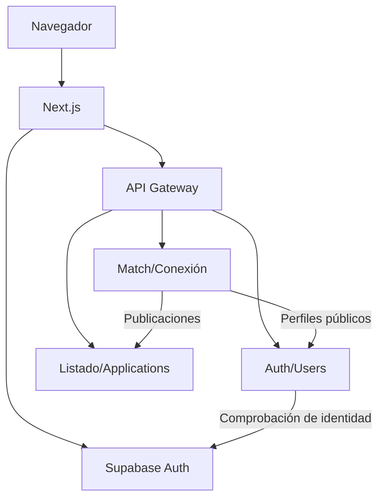

# SCRUM-99 · Anexo técnico de reconciliación de ramas

**Estado: en revisión.** El destino acordado es `dev-web`. El parche está en el árbol de trabajo de la rama de Jira. La compilación del frontend y las pruebas de configuración pasaron. La integración por PR y la verificación entre servicios siguen pendientes.

## 1. Objetivo y alcance

Trasladar a la línea web los ajustes de comunicación entre microservicios y del registro con Supabase que el equipo había preparado sobre `main`. Este anexo identifica qué se trasladó, qué evidencia respalda el cambio y qué falta antes de integrarlo. El alcance comprende once archivos existentes y este documento. La aplicación móvil, las migraciones y la publicación de infraestructura quedan para decisiones separadas.

## 2. Estado inicial de las ramas

| Referencia local inspeccionada | Commit | Papel en la reconciliación |
|---|---|---|
| `origin/main` | `a798f3c` | Base original. Contiene la web en `taller-de-integra-dos/roomies-web` y un árbol de TI IV en `taller de integra cuatro`. |
| `feature/SCRUM-99-reconciliacion` | `a798f3c` | Rama del trabajo de origen, según el equipo. La referencia apunta a ese commit. Los cambios originales fueron trasladados desde el árbol de trabajo mediante el parche. |
| `origin/dev-web` | `616747f` | Base elegida para integrar. Contiene la transición a Next.js y la web en `taller de integra dos/roomies-web`. |
| `SCRUM-99-Cerrar-la-reconciliación-de-ramas-y-publicar-el-anexo-técnico` | `616747f` | Rama creada desde Jira. En la revisión, su HEAD coincide con la base y los cambios están sin preparar para commit. |

La inspección se hizo en `C:\Proyectos\roomies-scrum99-dev-web` con las referencias Git disponibles localmente. El estado actual de GitHub requiere confirmación al preparar el PR.

## 3. Motivo para evitar un merge completo

El ancestro común de las referencias inspeccionadas es `1d50ba5`. La comparación `git rev-list --left-right --count origin/main...origin/dev-web` dio **98 commits exclusivos de main y 23 de dev-web**. Son recuentos de historia, no de funcionalidades pendientes. Un merge habría obligado a resolver simultáneamente diferencias de rutas, documentación, código móvil e historia de la web que excedían la decisión de SCRUM-99.

## 4. Traslado selectivo

Según el registro del equipo, se preparó `SCRUM-99-devweb-transfer.patch` a partir de los cambios originales y se aplicó sobre la rama de Jira con la carpeta web de `dev-web` como destino. La auditoría revisó el resultado en el worktree de destino. No fue necesario abrir el repositorio original ni volver a aplicar el parche.

El primer diff contenía **11 archivos, 183 inserciones y 19 eliminaciones**. Tras retirar una entrada de prueba, la revisión final del código quedó en **11 archivos, 182 inserciones y 19 eliminaciones**. Las cifras excluyen este anexo nuevo. Todos los archivos reconciliados están bajo la raíz web y el diff no contiene renombrados ni cambios móviles.

## 5. Inventario de los once archivos

Rutas relativas a `taller de integra dos/roomies-web`.

| Archivo | Cambio trasladado |
|---|---|
| `backend/service_runtime/settings.py` | Valida los orígenes de los servicios. Admite HTTP local con puerto explícito y HTTPS remoto en modo `supabase` para las tres variables de upstream previstas. Rechaza credenciales, rutas adicionales, consultas, fragmentos y caracteres inválidos. |
| `backend/local_stack/test_runtime.py` | Prueba destinos HTTPS permitidos, orígenes inválidos, nombres Docker y restricciones del modo desechable. Incluye la corrección de la sección 10. |
| `backend/services/match-conexion-service/app/infrastructure/clients.py` | Match admite `listado-applications`, nombre usado por Compose, además de `listado` al consultar publicaciones. |
| `docker-compose.local.yml` | Pasa `WEB_AUTH_RECOVERY_SECRET` al proceso web local. El valor por defecto queda vacío. |
| `frontend-next/src/app/(auth)/verificar/page.tsx` | Interpreta el estado `registro-recibido` y presenta una indicación informativa sobre el correo y el inicio de sesión. |
| `frontend-next/src/features/auth/AuthForm.tsx` | Tras el registro con Supabase, redirige a la verificación con el nuevo estado. |
| `frontend-next/src/features/auth/AuthScreen.tsx` | Distingue avisos informativos y errores al preparar la pantalla de confirmación. |
| `frontend-next/src/features/auth/EmailConfirmation.tsx` | Presenta la información con `role="status"` y mantiene los errores con `role="alert"`. |
| `frontend-next/src/lib/auth/gateway.ts` | Deriva la opción de autoconfirmación local del modo de laboratorio y de que el entorno esté fuera de producción. |
| `frontend-next/src/lib/auth/supabase.ts` | Unifica la respuesta pública del registro nuevo y duplicado, trata los límites y fallos del proveedor, y admite la respuesta autoconfirmada local sin abrir una sesión web durante el registro. |
| `frontend-next/tests/supabase-auth.test.mjs` | Añade casos para registro duplicado, confirmación requerida, autoconfirmación local y respuestas de error. |

## 6. Arquitectura y responsabilidades

Los dos manifiestos Compose definen cinco componentes de aplicación. El modo local añade PostgreSQL como dependencia. El frontend incluye una capa de servidor que gestiona la autenticación web y las cookies. El API Gateway de FastAPI es otro proceso y distribuye las peticiones de dominio.

| Componente | Responsabilidad en el flujo revisado |
|---|---|
| Next.js, `next-web` | Sirve la interfaz. En modo Supabase, su código de servidor coordina registro, confirmación PKCE y sesión. Envía las peticiones de dominio al gateway. |
| `api-gateway` | Encauza peticiones hacia Auth/Users, Listado/Applications y Match/Conexión según la ruta y el upstream configurado. |
| `auth-users` | Comprueba la identidad para las operaciones protegidas y gestiona perfiles y consultas de usuarios públicos. Supabase Auth actúa como proveedor de identidad en el modo correspondiente. |
| `listado-applications` | Gestiona publicaciones y postulaciones. Expone datos de publicaciones que consume Match. |
| `match-conexion` | Gestiona conexiones y búsquedas. Consulta perfiles públicos a Auth/Users y publicaciones a Listado/Applications por HTTP. |

## 7. Diagrama del modo Supabase

Las flechas representan dependencias presentes en el código o en Compose. El diagrama describe la topología configurada y omite el almacenamiento para destacar las llamadas entre componentes.



## 8. Entornos y evidencia disponible

| Entorno | Evidencia verificada | Pendiente de comprobar en ejecución |
|---|---|---|
| Desarrollo Windows | Pruebas locales con Python 3.13.3 en `.venv313` y dependencias npm instaladas. ESLint pasó en el frontend. | Transporte HTTP local y suites dependientes de sockets o enlaces de directorio. |
| Docker local | `docker-compose.local.yml` define web, gateway, tres servicios de dominio y `roomies-db`. Publica web y gateway por loopback en 3000 y 8010. | Arranque conjunto, salud y recorrido completo de una petición con esta revisión. |
| Supabase | `docker-compose.supabase.yml` define el modo compartido con proveedor de identidad y conexiones PostgreSQL por rol. Los tests de autenticación usan respuestas controladas. | Proyecto objetivo, confirmación de correo real, persistencia y sesión de extremo a extremo con cuentas de prueba. |
| Render | El validador admite orígenes HTTPS configurados para los tres upstreams en modo Supabase. | Inventario, revisión desplegada, salud y conectividad del gateway y los tres servicios de dominio. |
| Vercel | `frontend-next/vercel.json` declara Next.js, `npm ci` y `npm run build`. Se verificó compilación local. | Proyecto conectado, rama, directorio raíz, callback de correo y URL efectiva de preview o producción. |

La evidencia de esta tarea no acredita un despliegue de los cinco componentes. Los valores de configuración operativa se suministran en el entorno correspondiente.

## 9. Evidencia de validación

Resultados de las ejecuciones registradas sobre la rama de integración. Después de la corrección de una línea se repitió únicamente la suite de configuración. Las cifras de corridas sucesivas no se suman.

| Backend | Resultado |
|---|---|
| `backend/local_stack/test_runtime.py` | Antes de la corrección, 56 aprobadas y 1 fallida. Resultado final, **56 de 56 aprobadas**. |
| `backend/local_stack/test_auth.py` | 9 de 9 aprobadas. |
| `backend/local_stack/test_listado.py` | 18 de 18 aprobadas. |
| `backend/local_stack/test_match.py` | 6 de 6 aprobadas. |
| Clientes HTTP | Dos escenarios adicionales con transporte simulado aprobados en la revisión inicial. |
| `backend/api-gateway/tests/test_gateway.py` | 110 casos recopilados. La ejecución se detuvo en el primero, sin resultado de suite. |
| `backend/tests/run_isolated.py` | 133 casos recopilados. La ejecución se detuvo en el primero, sin resultado de suite. |

| Script del frontend | Resultado |
|---|---|
| `test:auth` | 13 de 13 aprobadas. |
| `test:auth-client` | 4 de 4 aprobadas. |
| `test:supabase-auth` | 18 de 18 aprobadas, incluido registro duplicado y confirmación PKCE con proveedor simulado. |
| `test:session` | 14 aprobadas de 15. El caso con servidor HTTP local recibió 503 y esperaba 200. |
| `test:api` | 7 de 7 aprobadas. |
| `test:admin` | 4 de 4 aprobadas. |
| `test:profile` | 15 de 15 aprobadas. |
| `test:applications` | 4 de 4 aprobadas. |
| `test:publications` | 9 de 9 aprobadas. |
| `test:connections` | 6 de 6 aprobadas. |
| `test:proxy` | 1 caso, bloqueado durante la preparación del entorno. |
| `lint` | ESLint terminó con código 0. |
| `typecheck` | `next typegen && tsc --noEmit` terminó con código 0. |
| `build` | Next.js 16.4.3 terminó con código 0 y generó las 4 páginas estáticas previstas. |

TypeScript y build se ejecutaron en una **copia temporal dentro del worktree**. Antes de ejecutarlos se comparó el contenido de los archivos versionados copiados con los del frontend, excluida la plantilla `.env.example`. Compilar y ejecutar tests con dobles acredita el comportamiento observado en esas condiciones. La entrega de correo, la conexión real entre servicios y el despliegue necesitan evidencia propia.

## 10. Corrección del caso con carácter nulo

El parámetro que contenía `\x00` fallaba en `monkeypatch.setenv()` con `ValueError: embedded null character`. Python rechazaba el valor antes de invocar `service_url()`. Se retiró exclusivamente esa entrada. Permanecen las demás URLs inválidas. Las huellas SHA-256 de los otros diez archivos, incluido el validador, coincidieron antes y después.

Desde la carpeta web se ejecutó:

```powershell
& '..\..\.venv313\Scripts\python.exe' -B -m pytest -q -p no:cacheprovider backend/local_stack/test_runtime.py
```

Resultado: **56 passed in 0.33s**. `git diff --check` terminó con código 0. La suite final cubre el conjunto de valores que quedó parametrizado.

## 11. Limitaciones reproducidas

| Comprobación | Punto de bloqueo | Evidencia que falta |
|---|---|---|
| API Gateway Python y backend aislado | Las trazas sitúan la espera en `socket.accept()` al crear el par de sockets interno de `asyncio` en Windows. Se interrumpieron las ejecuciones. | Resultado completo de ambas suites en un ejecutor que permita loopback. Los 243 casos recopilados quedaron sin veredicto. |
| Gateway de sesión web | Una conexión independiente al servidor de prueba en `127.0.0.1` reprodujo `EACCES`. | Repetir `test:session` con transporte local permitido y verificar el 200 esperado. |
| Proxy Next.js | La creación del enlace de directorio a `node_modules` falló con `EPERM`, antes de probar las rutas. | Repetir `test:proxy` con permiso para crear ese enlace y abrir sockets locales. |

## 12. Riesgos y observaciones HTTP

- **Errores preexistentes del proveedor.** La revisión estática encontró que login puede presentar un `5xx` como `401`, el reenvío como `422` y la verificación por código como `400`. Esto dificulta distinguir una caída del proveedor de un problema con los datos introducidos. El registro revisado traduce los `5xx` a `503`.
- **Límite de solicitudes.** El registro conserva `429` y sigue omitiendo `Retry-After`. El cliente carece del plazo que haya indicado el proveedor.
- **Destinos de servicios.** La validación comprueba modo, variable y sintaxis del origen. La selección del dominio y su resolución DNS dependen de la configuración operativa. Los clientes revisados de Match usan un timeout de cinco segundos y deshabilitan redirecciones y proxies heredados del entorno.
- **Recuperación local.** Compose permite dejar vacío `WEB_AUTH_RECOVERY_SECRET`. La recuperación responderá `503` si el secreto no cumple el mínimo de 32 caracteres. La autoconfirmación de laboratorio está acotada al entorno local fuera de producción.

## 13. Diferencias históricas que siguen abiertas

La ruta web con guiones en `main` y con espacios en `dev-web`, el árbol móvil de TI IV y la distinta evolución de documentación y frontend quedan fuera del traslado. El README de la base web conserva una referencia al móvil aunque su árbol raíz en `616747f` solo contiene el directorio de TI II junto a los archivos de raíz. Esto debe tenerse en cuenta al revisar enlaces o preparar una reconciliación más amplia.

La comparación de commits y directorios permite ubicar estas diferencias. La equivalencia funcional de cada commit y el inventario completo de cambios históricos requieren revisión separada. El equipo debe decidir qué elementos adicionales conservar o portar y en qué tarea hacerlo.

## 14. Procedimiento de PR hacia dev-web

1. El responsable de Git confirma que la rama de Jira sigue siendo la de origen y comprueba si `dev-web` avanzó desde `616747f`. Si cambió, revisa el diff contra la nueva base y repite las pruebas afectadas.
2. Revisa los once archivos y el anexo. Al preparar el commit selecciona esas doce rutas de forma explícita. Las copias de validación, cachés, dependencias y configuraciones privadas quedan fuera del conjunto a integrar.
3. Comprueba el diff preparado, la lista de archivos y los espacios en blanco. El responsable realiza el commit y push cuando el equipo lo autorice.
4. Abre el PR con la rama de Jira como origen y **`dev-web` como base**. Vincula SCRUM-99, incluye el enlace a este anexo y distingue pruebas aprobadas de verificaciones bloqueadas.
5. Adjunta los resultados de las repeticiones en un entorno compatible. El equipo revisa el alcance y las diferencias históricas, y decide la aprobación del PR y el cierre de Jira por separado.

## 15. Continuidad con SCRUM-100

Este anexo proporciona a los trabajos posteriores de despliegue una base de código identificada, la topología esperada y una lista de pruebas pendientes. Para SCRUM-100, el equipo debe confirmar en Jira el alcance, responsables y criterios de aceptación. Como evidencia de despliegue conviene registrar el commit efectivamente publicado, el entorno, la salud del gateway y de cada servicio de dominio, la conexión del frontend y un recorrido autorizado de registro, correo, login y perfil con una cuenta de prueba.

Quedan por confirmar también los proyectos y ramas de Render/Vercel, el proyecto Supabase de prueba y la asignación de las observaciones HTTP preexistentes. La publicación de este anexo mediante PR y el estado final de ambos tickets dependen de la revisión del equipo.
